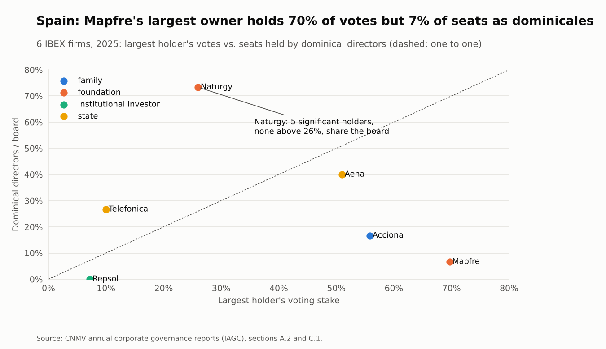

# ownership-and-boards

**Corporate governance research: who gets a seat on the board?** How combinations of owners (business groups, families, foundations, the State, pension funds and institutional investors) translate into board seats in two markets with concentrated ownership, Chile and Spain, built from the regulators' public filings.

> In financial-risk work I turn regulatory filings into clean, validated panels that keep themselves up to date. This project applies the same approach to a research question in corporate governance. It uses public data only. This is a pilot: the data, the descriptive evidence and the question are in place; the tests of the hypotheses are the next step.

## Results

- **Chilean ownership became more concentrated and less contestable.** Across 30 large listed firms, the largest shareholder's median stake rose from 35% in 2010 to 40% in 2025, the second holder's stake fell from 0.42 to 0.33 of the first's, and the median number of shareholders fell by 30% (1,528 to 1,063). In 2025, 16 of the 30 firms had no blockholder (5% or more) other than corporate vehicles.
- **Controllers reach the Spanish board through different doors.** Fundación Mapfre holds 70% of Mapfre's votes but 1 of its 15 seats as a dominical director (the board has 5 executives); the Entrecanales family holds 56% of Acciona through two companies and 2 of 12 dominical seats. Where no owner controls, the owners split the board: Naturgy's five significant holders (none above 26%) held 11 of its 15 seats in 2025. Counting only dominical directors understates a controller's presence when it governs through executives.
- **Independence rose, and a disclosure meant to measure representation is reported inconsistently.** Independents went from 45% to 53% of the board in seven IBEX firms (2015-2025). The share of voting rights "represented on the board", reported since 2021, moved at Acciona from 1% (2021-22) to 56% (2023) with the same owners, so it cannot be used without checking it against the shareholdings.

<picture>
  <source media="(prefers-color-scheme: dark)" srcset="docs/figures/representation-dark.png">
  
</picture>

## What this shows

| Research task | Where it is done here |
|---|---|
| Find which public sources can be downloaded in a structured way | Five rounds of cheap probes in GitHub Actions, results as annotations ([`probe.py`](src/boards/probe.py)) |
| Build a firm-year panel from regulatory filings | CMF company pages: 12 largest shareholders, number of shareholders and director spells with start and end dates ([`cmf.py`](src/boards/cmf.py)); CNMV governance reports cached as text and word positions ([`cnmv.py`](src/boards/cnmv.py)) |
| Read tables out of PDF reports | Board counts from the model's summary lines; significant holdings read from word positions, with name lines balanced around each row of percentages and aligned with known holders ([`iagc.py`](src/boards/iagc.py)) |
| Classify owners transparently | Ordered rules on holder names, tested on real names, plus a reviewed list of significant holders with family vehicles grouped by family ([`owners.py`](src/boards/owners.py), [`holders_es.yaml`](config/holders_es.yaml)) |
| Measure ownership constellations and boards | Concentration, contestability, stakes by owner type, blockholder combinations, board composition and seats shared with listed shareholders ([`chile.py`](src/boards/chile.py), [`report.py`](src/boards/report.py)) |
| Keep it current without manual work | The download resumes where it stopped, then the panels, figures and the block below are rebuilt |

## Latest reading

<!-- latest:start -->
**Latest reading: 2025.** In 2025 the largest shareholder of a large Chilean listed firm held a median 40% (against 35% in 2010); in Spain, independents held 53% of board seats and dominicales 28% in 2025.

| Indicator | Latest | Baseline | Change |
|---|---:|---:|---:|
| Chile: largest holder's stake, median | 39.5% | 34.6% | +4.9 pp |
| Chile: 2nd / 1st holder, median | 0.33 | 0.42 | -0.09 |
| Chile: number of shareholders, median | 1,062 | 1,528 | -465 |
| Spain: independent directors, average share | 53% | 45% | +8 pp |
| Spain: dominical directors, average share | 28% | 31% | -3 pp |

*Baseline: Chile 2010, Spain 2015. Sample: 30 Chilean and 7 Spanish listed firms (pilot). Updated on 2026-10-29.*
<!-- latest:end -->

## The question and why it matters

Corporate governance research has moved from *how much* ownership is concentrated to *who* the owners are and how their combinations work together (Aguilera and Crespí-Cladera, 2016; Federo et al., 2020). With concentrated ownership, owners and the board substitute for each other as monitors, and the effect depends on the type of controlling owner (Desender, Aguilera, Crespí and García-Cestona, 2013). Recent work measures how far a controlling shareholder's board seats exceed its stake ("over-appointment of directors"), but almost all of it uses Chinese data.

Chile and Spain share concentrated ownership and the same central conflict, between the controller and minority shareholders, but give minorities different routes to the board: cumulative voting and the pension funds' coordinated vote in Chile (Ley 18.046 art. 66; DL 3.500 art. 155); proportional representation and declared dominical directors in Spain (Ley de Sociedades de Capital art. 243). The working question is therefore:

> **How do ownership constellations translate into board seats, in two concentrated-ownership markets with different channels of minority voice?**

Three hypotheses guide the next step, not yet tested: the controller's over-representation grows with concentration; a second large owner of a different type reduces it and makes room for independents; and the type of minority owner changes the channel (independents for pension funds and institutions, dominical seats for families and corporations).

## Method

**Data.** Chile: the CMF company pages for 30 large listed firms, December 2010 to 2025 (12 largest shareholders, number of shareholders) and every director spell since 2008 with RUT, role, appointment and end date. Spain: the CNMV annual corporate governance reports (IAGC) of 7 IBEX firms, 2015-2025; only the ownership and board pages are kept, as text and word positions. These are the regulators' public websites, not the CMF API.

**Owner types.** Corporate, family (Spain, from a reviewed list), individual, State, foreign State, pension fund (AFP), institutional investor, bank, foundation or association, and, in the Chilean top-12 tables, custodian and broker accounts (shares held for clients, which hide the final owner).

**Measures.** Largest holder's stake; top-3; Herfindahl index over the 12 largest; contestability (2nd/1st); stakes by type; the constellation (types holding 5% or more); board size and shares of executive, dominical and independent directors; seats held by directors who also sit on the board of a listed shareholder.

## Validation

- Figures checked against the filings: ENAIRE's 51% of Aena and Copec's 60.82% held by AntarChile, both as reported.
- 95% of the Spanish significant holders are matched to a reviewed holder; the rest keep their raw name and are flagged in [`holders_es.csv`](data/processed/holders_es.csv).
- The CMF director register is incomplete for some firm-years (LATAM, Enel Chile and SQM list fewer directors than they have); board measures use only firm-years with at least 5 directors (`board_complete`).
- 40 offline tests cover the parsers and the owner rules; `ruff` and `pytest` run on every push.

**Limitations of the pilot.** Small samples (30 and 7 firms). In Chile, who each director represents is not declared, so representation must be inferred (shared directors, AFP-elected directors); custodian accounts hide part of the ownership. Five Spanish firms are missing because their CNMV identifier did not resolve. Holder names in the most irregular Spanish tables (Naturgy 2019-2024) are partly unmatched.

## Next steps

1. All Chilean issuers' boards (about 340 firms) to trace group networks, and the directors elected with pension-fund votes.
2. The full list of Spanish listed firms, and executives linked to the controller counted with the dominical directors.
3. A firm-level measure of over-appointment for both countries and the tests of the three hypotheses.

## Automation

[`pilot.yml`](.github/workflows/pilot.yml) downloads the data in two parallel jobs that resume where the last run stopped, then rebuilds the panels, the figures, [`latest.json`](latest.json) and the block above. Run locally with `boards fetch-cl`, `boards fetch-es` and `boards report`.

## License

MIT
